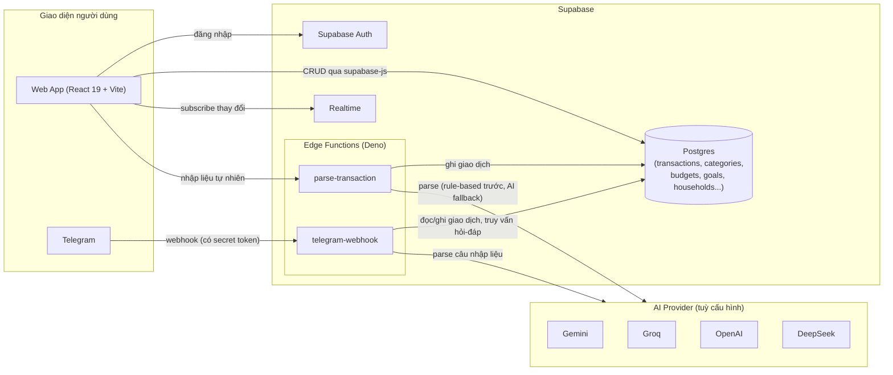
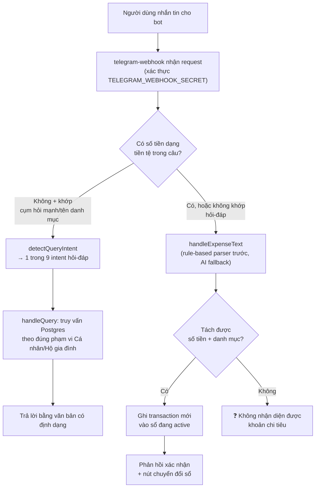
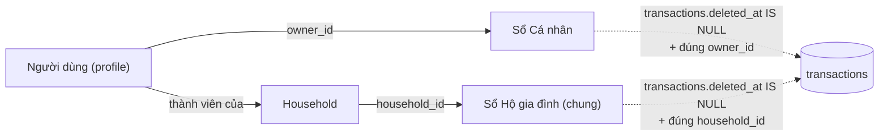

# 💰 Smart Spend Tracker

**Quản lý chi tiêu cá nhân & hộ gia đình thông minh — nhập liệu bằng AI (web + Telegram bot), ngân sách tự động, tích lũy mục tiêu, và trợ lý hỏi‑đáp tài chính thời gian thực.**


> ⚠️ **Lưu ý quan trọng**: Đây là dự án đang phát triển tích cực (xem [`TASKS.md`](./TASKS.md) để biết tiến độ thật). README này mô tả đúng những gì **đã có trong code**, không mô tả tính năng dự định nhưng chưa làm. Dữ liệu tài chính của người dùng được lưu trên Supabase (Postgres) do chính bạn tự host/sở hữu project — không có server trung gian nào khác ngoài các API AI (Gemini/Groq/OpenAI/DeepSeek) mà bạn tự cấu hình key.

---

## 📖 Mục lục

- [Giới thiệu](#-giới-thiệu)
- [Vấn đề & giải pháp](#-vấn-đề--giải-pháp)
- [Tính năng chính](#-tính-năng-chính)
- [Kiến trúc hệ thống](#-kiến-trúc-hệ-thống)
- [Công nghệ sử dụng](#-công-nghệ-sử-dụng)
- [Cấu trúc thư mục](#-cấu-trúc-thư-mục)
- [Cài đặt & chạy local](#-cài-đặt--chạy-local)
- [Cấu hình biến môi trường & secrets](#-cấu-hình-biến-môi-trường--secrets)
- [Triển khai (Deploy)](#-triển-khai-deploy)
- [Kiểm thử](#-kiểm-thử)
- [Quy trình phát triển & tài liệu sống](#-quy-trình-phát-triển--tài-liệu-sống)
- [Giới hạn & rủi ro kỹ thuật đã biết](#-giới-hạn--rủi-ro-kỹ-thuật-đã-biết)
- [Lộ trình phát triển](#-lộ-trình-phát-triển)
- [Đóng góp](#-đóng-góp)
- [License](#-license)

---

## 🎯 Giới thiệu

**Smart Spend Tracker** là ứng dụng web (React + Vite) kết hợp **bot Telegram** giúp cá nhân và hộ gia đình ghi chép, theo dõi và phân tích chi tiêu mà **không cần gõ form thủ công**. Điểm khác biệt chính:

1. **Nhập liệu bằng ngôn ngữ tự nhiên** — gõ (hoặc nhắn Telegram) kiểu *"Cà phê sáng 35k"*, *"Ăn tối hộ gia đình 200k"* → AI tự tách số tiền, danh mục, ghi nhận giao dịch, không cần chọn dropdown.
2. **Dùng chung 1 bot Telegram cho mọi người dùng** — định danh qua `telegram_chat_id` gắn với từng tài khoản, tự nhận diện bạn đang ghi vào sổ **Cá nhân** hay **Hộ gia đình**.
3. **Trợ lý hỏi‑đáp qua Telegram** — hỏi thẳng *"Tháng này ăn uống hết bao nhiêu?"*, *"Ngân sách du lịch còn lại bao nhiêu?"*, bot truy vấn dữ liệu thật và trả lời ngay, không cần mở app.
4. **Ngân sách & tích lũy tự động** — đặt hạn mức theo danh mục, mục tiêu tiết kiệm, cấu hình trích tự động từ thu nhập.
5. **Smart Advisor** — phân tích xu hướng chi tiêu, gợi ý điều chỉnh ngân sách.

**Đối tượng sử dụng**: cá nhân hoặc hộ gia đình muốn quản lý tài chính sát sao nhưng ngại thao tác nhập liệu thủ công rườm rà của các app quản lý chi tiêu truyền thống.

---

## 💡 Vấn đề & giải pháp

| Nỗi đau thực tế | Cách Smart Spend Tracker giải quyết |
| --- | --- |
| Ghi chép chi tiêu thủ công (chọn ngày, danh mục, nhập số tiền qua form) khiến người dùng bỏ cuộc sau vài ngày | Gõ một câu tự nhiên trên web hoặc **nhắn tin Telegram** — AI tự parse thành giao dịch hoàn chỉnh |
| Vợ/chồng hoặc các thành viên trong nhà ghi chi tiêu rời rạc, không ai biết tổng quan chi tiêu chung | Mô hình **Cá nhân / Hộ gia đình** tách bạch rõ (`owner_id` vs `household_id`), chuyển đổi sổ ngay trong hội thoại Telegram |
| Muốn biết nhanh "tháng này tiêu bao nhiêu" nhưng phải mở app, chọn bộ lọc, chờ load | **Hỏi trực tiếp bot Telegram**, trả lời tức thì dựa trên dữ liệu thật trong Postgres |
| Đặt ngân sách nhưng không ai nhắc khi gần vượt hạn mức | Theo dõi **Ngân sách** theo danh mục + cảnh báo khi chi gần/vượt hạn mức |
| Khó hình thành thói quen tiết kiệm có mục tiêu cụ thể | **Tích Lũy** (saving goals) + cấu hình **trích tự động** theo tỷ lệ/số tiền cố định |

---

## ✨ Tính năng chính

| Khu vực (trên web) | Mô tả |
| --- | --- |
| 📊 **Phân Tích** | Dashboard tổng quan thu/chi, biểu đồ xu hướng (Recharts) |
| 🤖 **Nhập Liệu AI** | Nhập chi tiêu bằng câu tự nhiên, AI tự tách số tiền/danh mục/ghi chú |
| 📒 **Sổ Giao Dịch** | Danh sách giao dịch, lọc theo thời gian/danh mục/thành viên, sửa/xoá, xuất Excel |
| 💰 **Ngân Sách** | Đặt hạn mức chi tiêu theo danh mục, theo dõi phần trăm đã dùng |
| 🏦 **Tích Lũy** | Mục tiêu tiết kiệm, cấu hình trích tự động (`AutoContributionConfig`) |
| 🧠 **Smart Advisor** | Gợi ý phân bổ ngân sách dựa trên lịch sử chi tiêu (`SmartAllocator`) |
| 👨‍👩‍👧 **Hộ Gia Đình** | Quản lý thành viên, mời tham gia, xem sổ chung |
| ⚙️ **Cài Đặt** | Liên kết tài khoản Telegram (`TelegramLinkCard`), tuỳ chỉnh danh mục/icon |

### Bot Telegram — 2 chế độ

| Chế độ | Mô tả |
| --- | --- |
| **Khai báo giao dịch** | Nhắn kiểu *"Mua cá kho 50k"* → bot phân tích (quy tắc + AI fallback), tự chọn danh mục khớp nhất, ghi vào sổ đang active (Cá nhân/Hộ gia đình), phản hồi xác nhận kèm nút **"Chuyển sang Hộ gia đình/Cá nhân"**. |
| **Hỏi‑đáp tài chính** | Nhận diện câu hỏi (không có ý định ghi giao dịch) và trả lời theo 9 nhóm: tổng thu/chi theo kỳ, số dư luỹ kế, chi theo danh mục, hạn mức ngân sách còn lại, tiến độ mục tiêu tiết kiệm, giao dịch gần đây, khoản chi lớn nhất, so sánh giữa các tháng, trạng thái trích tự động. |

> Chi tiết đặc tả đầy đủ (toàn bộ acceptance criteria từng tính năng) nằm trong [`PRD.md`](./PRD.md).

---

## 🏗️ Kiến trúc hệ thống

### Tổng quan hệ thống



### Luồng xử lý 1 tin nhắn Telegram



### Phạm vi dữ liệu Cá nhân / Hộ gia đình

Mọi truy vấn (cả từ web lẫn bot) đều phải đi qua đúng 1 trong 2 phạm vi — đây là ranh giới bảo mật dữ liệu quan trọng nhất của hệ thống, đặc biệt với Edge Function dùng `SUPABASE_SERVICE_ROLE_KEY` (bỏ qua Row Level Security):



> Chi tiết đầy đủ về quy ước kiến trúc, interface, và ranh giới "được tự làm / phải hỏi trước / tuyệt đối không làm" nằm trong [`CONSTITUTION.md`](./CONSTITUTION.md).

---

## 🛠️ Công nghệ sử dụng

| Hạng mục | Công nghệ | Vai trò |
| --- | --- | --- |
| Ngôn ngữ | TypeScript 5.8 | Toàn bộ frontend + Edge Functions |
| Frontend framework | React 19 + Vite 6 | SPA, dev server nhanh, HMR |
| Styling | Tailwind CSS 4 | Utility-first CSS |
| Server-side (dev/preview) | Express + `tsx` / `esbuild` | Server chạy app khi build production (`server.ts` → `dist/server.cjs`) |
| State/data fetching | TanStack React Query 5 | Cache, đồng bộ dữ liệu server |
| Biểu đồ | Recharts | Dashboard phân tích chi tiêu |
| Icon | lucide-react | Bộ icon UI |
| Animation | Motion (Framer Motion) | Hiệu ứng chuyển động UI |
| Backend-as-a-Service | **Supabase** (Postgres, Auth, Realtime, Edge Functions) | Toàn bộ backend, không có server Node riêng cho nghiệp vụ |
| Edge Functions runtime | Deno (qua Supabase Functions) | `parse-transaction`, `telegram-webhook` |
| AI nhập liệu/hỏi-đáp | Gemini / Groq / OpenAI / DeepSeek (tuỳ cấu hình key) | Parse câu tự nhiên thành giao dịch có cấu trúc |
| Bot | Telegram Bot API (webhook, có secret token xác thực) | Kênh nhập liệu + hỏi-đáp thay thế cho web |
| Testing | Vitest, script Node/Python độc lập trong `verify/` | Unit test service layer + verify logic nghiệp vụ có kịch bản thật |

---

## 📂 Cấu trúc thư mục

```
smart-spend-tracker/
├── src/
│   ├── components/        # FinancialDashboard, SmartInput, TransactionHistory,
│   │                       # BudgetLimits, SavingGoals, SmartAllocator,
│   │                       # HouseholdManagement, Settings, TelegramLinkCard...
│   ├── context/            # React Context (auth, scope Cá nhân/Hộ gia đình...)
│   ├── hooks/               # Custom hooks (data fetching, mutations qua React Query)
│   ├── services/             # Lớp gọi Supabase (service layer)
│   │   └── __tests__/         # Unit test cho service layer (Vitest)
│   └── lib/                    # Hàm tiện ích dùng chung (format tiền, tính luỹ kế...)
├── supabase/
│   ├── functions/
│   │   ├── _shared/            # Logic parse giao dịch dùng chung
│   │   ├── parse-transaction/   # Edge Function: nhập liệu AI từ web
│   │   └── telegram-webhook/     # Edge Function: bot Telegram (khai báo + hỏi-đáp)
│   │       ├── index.ts              # Entrypoint CLI deploy thật (import từ _shared)
│   │       ├── telegram-webhook-index.ts   # Bản phụ
│   │       └── telegram-webhook-merged.ts  # Bản gộp 1 file để dán qua Dashboard editor
│   └── migration/              # 60+ file migration SQL (đánh số theo task T-S...)
├── verify/                   # Script verify logic nghiệp vụ độc lập (Node/Python)
├── check_list_tests/          # Checklist test thủ công theo từng task
├── CONSTITUTION.md             # Quyết định kiến trúc khoá cứng, bảng ranh giới ASK FIRST/NEVER
├── PRD.md                       # Đặc tả sản phẩm, acceptance criteria
├── TASKS.md                      # Ledger task nguyên tử, trạng thái ⚪/🟡/🔒
├── CHANGELOG.md                   # Lịch sử từng task đã hoàn thành
├── .env.example                    # Mẫu biến môi trường (KHÔNG chứa key thật)
├── package.json
└── README.md
```

> ⚠️ **Rủi ro kỹ thuật đang tồn tại**: `telegram-webhook` hiện có **3 bản file song song** phải đồng bộ tay (xem mục [Giới hạn & rủi ro kỹ thuật](#-giới-hạn--rủi-ro-kỹ-thuật-đã-biết)).

---

## 🚀 Cài đặt & chạy local

### Yêu cầu

- Node.js 18+ (khuyến nghị 20+)
- Tài khoản [Supabase](https://supabase.com) (có thể dùng free tier để phát triển)
- API key của **ít nhất 1** AI provider: [Gemini](https://ai.google.dev), [Groq](https://console.groq.com), [OpenAI](https://platform.openai.com) hoặc DeepSeek
- (Tuỳ chọn, nếu phát triển bot) Bot Telegram riêng tạo qua [@BotFather](https://t.me/BotFather)

### Các bước

```bash
git clone <URL-repo-của-bạn>
cd smart-spend-tracker

npm install

cp .env.example .env            # Linux/macOS
# hoặc: copy .env.example .env  # Windows CMD

# Mở .env, điền:
#   GEMINI_API_KEY, APP_URL, VITE_SUPABASE_URL, VITE_SUPABASE_ANON_KEY
# (lấy VITE_SUPABASE_URL / VITE_SUPABASE_ANON_KEY tại
#  Supabase Dashboard → Project Settings → API)

npm run dev
```

Ứng dụng chạy tại cổng Vite mặc định (xem log terminal sau `npm run dev`).

### Các lệnh npm script chính

| Lệnh | Mục đích |
| --- | --- |
| `npm run dev` | Chạy dev server (`tsx server.ts`) |
| `npm run build` | Build production (Vite build + bundle `server.ts` bằng esbuild) |
| `npm run start` | Chạy bản đã build (`dist/server.cjs`) |
| `npm run lint` | Kiểm tra type bằng `tsc --noEmit` |
| `npm test` | Chạy unit test (Vitest) — cần `.env.test` trỏ tới Supabase project **test riêng** |
| `npm run clean` | Xoá `dist/` và `server.js` |

---

## 🔑 Cấu hình biến môi trường & secrets

Có **2 nhóm secrets khác nhau**, không được nhầm lẫn nơi lưu:

### 1. Biến môi trường phía Web (`.env`, prefix `VITE_` sẽ lộ ra bundle client)

| Biến | Dùng cho | Lấy ở đâu |
| --- | --- | --- |
| `VITE_SUPABASE_URL` | Kết nối Supabase từ client | Supabase Dashboard → Project Settings → API |
| `VITE_SUPABASE_ANON_KEY` | Supabase client (public, được bảo vệ bởi Row Level Security) | Supabase Dashboard → Project Settings → API |
| `GEMINI_API_KEY` | Gọi Gemini cho nhập liệu AI | Google AI Studio |
| `APP_URL` | URL app đã deploy (OAuth callback, self-reference) | Tuỳ nơi deploy |

`.env.test` (biến riêng, **không dùng chung project production**):

| Biến | Dùng cho |
| --- | --- |
| `VITE_TEST_USER_EMAIL` / `VITE_TEST_USER_PASSWORD` | Tài khoản test cho `npm test` |

> `VITE_SUPABASE_ANON_KEY` **không phải** secret tuyệt mật (nó được thiết kế để public trong bundle client, bảo mật thật nằm ở Row Level Security của Postgres) — nhưng vẫn **không nên commit `.env`** để tránh lẫn với các key khác trong cùng file và để mỗi môi trường (dev/test/prod) tự quản key riêng.

### 2. Secrets phía Edge Functions (Supabase, **KHÔNG** nằm trong `.env` của web)

Các Edge Function (`parse-transaction`, `telegram-webhook`) đọc secrets qua `Deno.env.get(...)`, được set **trực tiếp trên Supabase**, không qua file `.env` của web:

| Biến | Dùng cho | Mức độ nhạy cảm |
| --- | --- | --- |
| `SUPABASE_URL`, `SUPABASE_SERVICE_ROLE_KEY` | Edge Function thao tác DB **bỏ qua Row Level Security** | 🔴 **Rất nhạy cảm** — lộ key này = toàn quyền đọc/ghi mọi dữ liệu mọi người dùng |
| `TELEGRAM_BOT_TOKEN` | Gọi Telegram Bot API gửi tin nhắn | 🔴 Rất nhạy cảm — lộ = ai cũng điều khiển được bot |
| `TELEGRAM_WEBHOOK_SECRET` | Xác thực request webhook thật sự đến từ Telegram | 🟠 Nhạy cảm |
| `GEMINI_API_KEY` / `GROQ_API_KEY` / `OPENAI_API_KEY` / `DEEPSEEK_API_KEY` | AI provider cho bot (tuỳ provider đang bật) | 🟠 Nhạy cảm (rủi ro phát sinh phí) |

Set secrets bằng CLI (không bao giờ hardcode trong code):

```bash
supabase secrets set TELEGRAM_BOT_TOKEN=xxxx TELEGRAM_WEBHOOK_SECRET=xxxx \
  GROQ_API_KEY=xxxx --project-ref <project-ref>
```

`SUPABASE_URL` và `SUPABASE_SERVICE_ROLE_KEY` thường đã được Supabase tự inject sẵn cho Edge Function trong project đó — chỉ cần set thêm các key còn lại.

---

## 📦 Triển khai (Deploy)

### 1. Database (migrations)

```bash
supabase link --project-ref <project-ref>
supabase db push --linked
```

> Repo có **60+ file migration** đánh số theo task (`T-S...`) trong `supabase/migration/` — luôn `db push` theo đúng thứ tự, không tự ý sửa migration đã apply production, chỉ thêm migration mới (đúng nguyên tắc trong `CONSTITUTION.md`).

### 2. Edge Functions

```bash
supabase functions deploy parse-transaction --project-ref <project-ref>
supabase functions deploy telegram-webhook --project-ref <project-ref>
```

> ⚠️ Lệnh trên deploy đúng `supabase/functions/telegram-webhook/index.ts` (entrypoint chuẩn, import từ `_shared/`). Nếu trước đó bạn từng dán tay `telegram-webhook-merged.ts` qua Dashboard "Via Editor", **hãy xác nhận lại bản nào đang thật sự chạy** trước khi deploy đè — 2 bản này có thể lệch nhau (xem [Giới hạn & rủi ro kỹ thuật](#-giới-hạn--rủi-ro-kỹ-thuật-đã-biết)).

### 3. Đăng ký webhook Telegram (1 lần, hoặc khi đổi URL/secret)

```bash
curl -X POST "https://api.telegram.org/bot<TELEGRAM_BOT_TOKEN>/setWebhook" \
  -H "Content-Type: application/json" \
  -d '{
    "url": "https://<project-ref>.supabase.co/functions/v1/telegram-webhook",
    "secret_token": "<TELEGRAM_WEBHOOK_SECRET>"
  }'
```

### 4. Frontend

```bash
npm run build
npm run start   # hoặc deploy dist/ + server.cjs lên nền tảng hosting bạn chọn
```

---

## 🧪 Kiểm thử

```bash
npm test                          # Vitest — unit test service layer (cần .env.test)
node verify/<tên-file>.mjs        # Verify logic nghiệp vụ theo từng task (xem thư mục verify/)
```

- `verify/` chứa các script mô phỏng logic độc lập (không gọi Edge Function thật) để kiểm tra nhanh các hàm thuần (routing intent, merge dữ liệu...).
- **Giới hạn quan trọng**: các script trong `verify/` test logic **cục bộ**, không xác nhận hành vi của Edge Function **đã deploy thật** trên Supabase. Luôn thử tay qua Telegram/web sau khi deploy, không chỉ dựa vào `verify/` pass.

---

## 🤝 Quy trình phát triển & tài liệu sống

Dự án theo quy trình lặp nhỏ, mỗi task nguyên tử đều có tiêu chí nghiệm thu rõ ràng trước khi code:

| File | Vai trò |
| --- | --- |
| [`CONSTITUTION.md`](./CONSTITUTION.md) | Quyết định kiến trúc khoá cứng, quy ước đặt tên, interface, và bảng ranh giới **ALWAYS DO / ASK FIRST / NEVER DO** |
| [`PRD.md`](./PRD.md) | Đặc tả sản phẩm đầy đủ — mục tiêu, người dùng, danh sách tính năng ưu tiên, acceptance criteria |
| [`TASKS.md`](./TASKS.md) | Ledger task nguyên tử, trạng thái ⚪ chưa làm / 🟡 đang làm / 🔒 xong + đã verify |
| [`CHANGELOG.md`](./CHANGELOG.md) | 1 entry ngắn mỗi task hoàn thành: đã làm gì, đánh đổi gì, điều gì **CHƯA kiểm chứng thật** |

Một phần codebase được phát triển với sự hỗ trợ của AI pair-programming — mọi thay đổi đều được viết test riêng (Vitest hoặc script trong `verify/`) trước khi coi là hoàn thành, không nhận code/logic không qua kiểm chứng.

---

## ⚠️ Giới hạn & rủi ro kỹ thuật đã biết

- **3 bản file `telegram-webhook` song song** (`index.ts`, `telegram-webhook-index.ts`, `telegram-webhook-merged.ts`) phải đồng bộ tay — rủi ro deploy nhầm bản cũ. Cần xác nhận rõ bản nào đang chạy production trước mỗi lần sửa.
- **AMOUNT_REGEX nhận diện "có số tiền" trong tin nhắn hiện còn quá rộng** (khớp cả số trần không có đơn vị tiền, ví dụ ngày tháng) — có thể khiến câu hỏi chứa ngày tháng bị hiểu nhầm thành khai báo giao dịch. Xem ghi chú trong `CONSTITUTION.md`/`TASKS.md` phần liên quan đến `detectQueryIntent`.
- Script trong `verify/` chỉ test logic cục bộ, không thay thế việc test tay trên bot/app thật sau khi deploy.
- Chưa có pipeline CI/CD tự động chạy test + deploy — các bước deploy ở trên hiện làm thủ công.

---

## 🗺️ Lộ trình phát triển

Theo dõi chi tiết, cập nhật liên tục tại [`TASKS.md`](./TASKS.md). Tóm tắt nhóm tính năng theo `PRD.md`:

| Nhóm | Trạng thái tổng quát |
| --- | --- |
| Nhập liệu AI (web + Telegram), Sổ giao dịch, Ngân sách, Tích luỹ, Hộ gia đình | ✅ Đã có trong code |
| Chế độ Hỏi‑đáp qua Telegram (9 nhóm câu hỏi tài chính) | 🟡 Đang hoàn thiện, xem trạng thái từng intent trong `TASKS.md` |
| CI/CD tự động | ⏳ Chưa làm |
| Đồng bộ 3 bản `telegram-webhook` thành 1 nguồn duy nhất | ⏳ Nợ kỹ thuật cần giải quyết |

---

## 🙋 Đóng góp

Xem [`GIT_GUIDE.md`](./GIT_GUIDE.md) để biết quy trình đẩy code lên GitHub an toàn (tránh lộ key) và quy trình làm việc nhóm (branching, tránh conflict).

Nguyên tắc chung khi sửa code:
1. Đọc `CONSTITUTION.md` trước — đặc biệt bảng ASK FIRST / NEVER DO.
2. Lấy đúng 1 task từ `TASKS.md`, không làm nhảy cóc ngoài thứ tự phụ thuộc.
3. Viết/chạy test xác nhận trước khi coi task là xong.
4. Cập nhật `CHANGELOG.md` và đổi trạng thái task trong `TASKS.md`.

---

## 📄 License

Dự án hiện **chưa công bố license** (không có file `LICENSE`). Nếu dự định phát hành mã nguồn public, cân nhắc thêm [MIT](https://choosealicense.com/licenses/mit/) hoặc license phù hợp trước khi chia sẻ rộng rãi. Nếu đây là dự án cá nhân/nội bộ không muốn public, đảm bảo repository trên GitHub được tạo ở chế độ **Private** (xem `GIT_GUIDE.md`).

---

<p align="center">Made with React, Supabase và rất nhiều lần verify trước khi deploy thật 🇻🇳</p>
